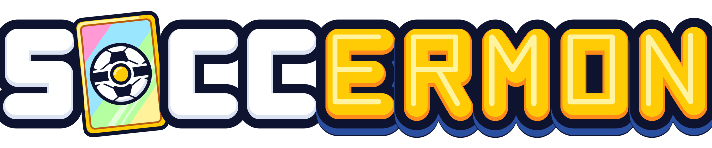
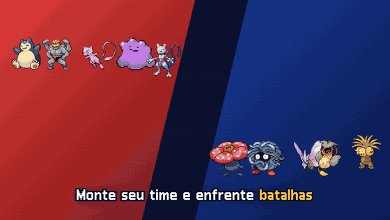
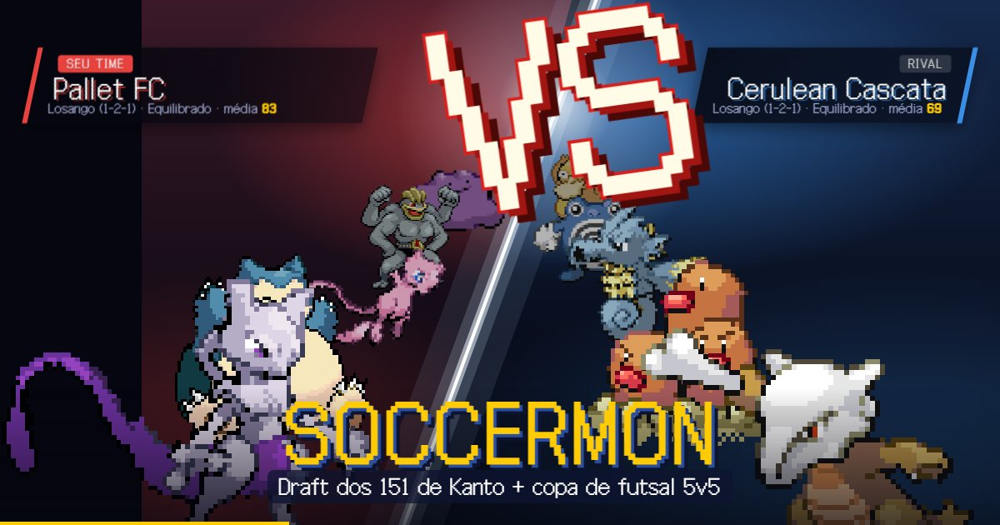
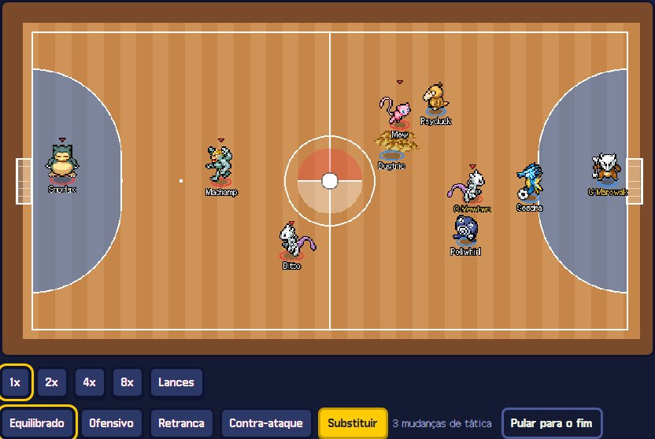

<p align="center">
  <a href="https://soccermon.com"></a>
</p>

<p align="center">
  <a href="https://soccermon.com"></a>
</p>

# Soccermon

**Jogue agora: [soccermon.com](https://soccermon.com)**

> **In English:** Soccermon is a free, non-profit browser fan game: draft a team from the 151 Kanto Pokémon
> ("pick 1 of 3", roguelike style) and play a simulated 5v5 futsal cup against gym-themed clubs, with real
> Gen 1 moves turned into futsal actions. No install, no ads, no purchases; play in English or Brazilian
> Portuguese (official English Pokémon names). Built with Vite, React 19, TypeScript, Phaser 4 and a deterministic headless match engine;
> open source under AGPL-3.0.

Criado por **Miguel Cunha** ([@miguel20br](https://github.com/miguel20br)).

Fan game de navegador, **sem fins lucrativos**: monte um time com os 151 Pokémon de Kanto num draft
"escolha 1 de 3" e dispute uma copa de **futsal 5v5 simulado** contra clubes temáticos dos ginásios.



## O que tem no jogo

- **Draft roguelike**: formação (6 opções), capitão, 5 titulares e 2 reservas, com rerolls
- **Partida simulada** numa quadra 2D vista de cima, com sprites animados, narração em português ou
  inglês e velocidades de 1x a 8x
- **Golpes de verdade**: os 164 golpes da Gen 1 viram ações de futsal (chute, carrinho, buff, status), cada um
  com animação própria
- **Evolução no meio da partida**, substituições pedidas pelo técnico e táticas que mudam ao vivo
- **Sinergias** de tipo, duplas de história (Mew + Mewtwo, Pássaros Lendários...) e aura do capitão
- **Cartas** com raridade e edições especiais (Destaque, Ícone, Shiny, Evento da semana)
- **Estatísticas** da partida e da copa: notas, gráficos, mapa de chutes
- **Perfil** do seu clube (nome, sigla e cor), **Pokédex** (visto, jogou e carreira de cada espécie) e
  **Golpedex** com os golpes que você já descobriu
- **MT do ginásio**: vencer um ginásio pode render a MT do líder (Brock dá Bide, Misty dá Bubble Beam...) para
  ensinar a quem você quiser; golpes com o efeito dos jogos originais (crítico, carga, Fly/Dig, área, Toxic...)
- **Ajuda** com passo a passo e **Configurações**: velocidade, nomes na quadra, reduzir movimento e backup do save
- **Português ou inglês** (PT | EN na tela inicial), com os nomes oficiais em inglês dos jogos
- **Conta Google opcional** para salvar a copa na nuvem; sem login, tudo fica no seu navegador



Novidades de cada versão em [CHANGELOG.md](CHANGELOG.md).

## Rodando localmente

Precisa de Node.js 22 ou mais novo.

```bash
npm install
npm run dev        # http://localhost:8080
npm test           # testes do motor (Vitest)
npm run lint       # Biome
npm run build      # build estático em dist/
```

O jogo roda completo sem configurar nada (modo visitante). O login com Google e o save na nuvem só
aparecem com as variáveis do Supabase: copie `.env.example` para `.env.local` e preencha com as chaves
**públicas** do seu projeto (nunca a `service_role`). As tabelas e regras de acesso estão em
`supabase/migrations/`.

Atalhos de desenvolvimento (só no `npm run dev`): `?demo=penaltis`, `?demo=ditto`, `?demo=evolucao`,
`?demo=campeao`, `?cards=1` (galeria de cartas) e `?lab=posicoes`. O laboratório de golpes (`?lab=golpes`)
também está no site público.

Os dados e assets já estão no repositório. Para regenerar:

```bash
npm run data               # src/data/*.json a partir do @pkmn/dex + textos pt-BR
npm run assets:cards       # GIFs de Black/White (PokeAPI/sprites)
npm run assets:field       # atlas PMD por Pokémon (PMDCollab/SpriteCollab) + CREDITS-PMD.md
npm run assets:portraits   # retratos PMD + CREDITS-PORTRAITS.md
npm run assets:audio       # gritos (PokeAPI/cries) + partículas do Showdown
npm run assets:types       # ícones de tipo
npm run calibrate -- --n 1000   # balanceamento headless (gols, zebras, táticas, formações)
```

## Arquitetura

```
src/engine/   motor headless e determinístico (TS puro, sem Phaser): mesma seed + mesmas ordens = mesma partida
  match.ts            estado + step a 20 Hz → snapshots + eventos
  controllers/        IA estilo "Simple Soccer" e HumanController (modo jogável futuro)
  runners/            BatchRunner (Web Worker, calibração) e LiveRunner (tick a tick)
  moves.ts            golpe → ação de futsal · modifiers.ts: a regra única de bônus (carta = campo)
  draft.ts, cup.ts    draft 1-de-3 e adversários da copa
src/game/     Phaser 4: MatchScene toca os snapshots com interpolação; move-fx.ts anima os golpes
src/ui/       React 19: telas, cartas, estatísticas, narração
src/store/    Zustand com save em IndexedDB
src/cloud/    login Google e save na nuvem (Supabase), opcionais
```

## Contribuindo

Ideias, bugs e balanceamento são bem-vindos: veja [CONTRIBUTING.md](CONTRIBUTING.md). Achou uma falha de
segurança? Siga [SECURITY.md](SECURITY.md) em vez de abrir uma issue pública.

## Licença e créditos

- **Código**: © 2026 Miguel Cunha, sob [AGPL-3.0-or-later](LICENSE). Se você publicar uma versão modificada, o código dela também
  precisa ficar aberto.
- **Sprites, sons e dados de terceiros** não estão sob a AGPL: cada um segue a licença da sua fonte (várias
  só para uso **não comercial**, como os sprites PMD em CC BY-NC 4.0). Veja [CREDITS.md](CREDITS.md),
  [CREDITS-PMD.md](CREDITS-PMD.md) e [CREDITS-PORTRAITS.md](CREDITS-PORTRAITS.md).
- **Pokémon** e todos os nomes, imagens e sons relacionados são © Nintendo, Game Freak, Creatures Inc. e
  The Pokémon Company. Este projeto não é afiliado nem endossado por eles e não tem fins lucrativos.

Privacidade e termos de uso: [soccermon.com/privacidade.html](https://soccermon.com/privacidade.html).
