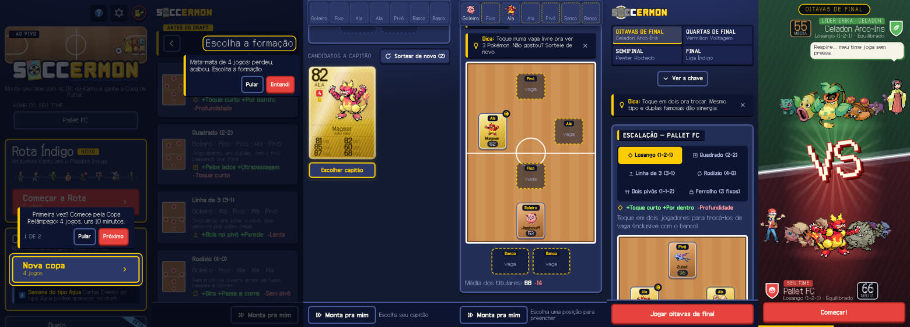
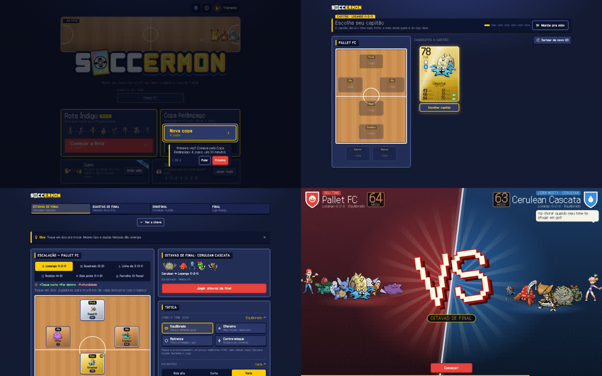
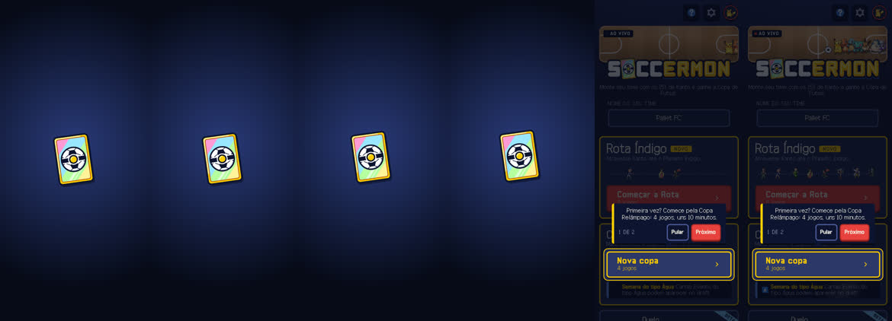

# Funil da entrada: quem abre e não começa a copa (23/10/2026, branch `funil`)

Pedido: o `npm run stats` aponta "Abriu o jogo → Passou das boas-vindas" como o maior vazamento (46% das sessões
novas param ali). Abaixo, o diagnóstico com números, prints e código, as opções e as decisões. Só proposta:
nada disso foi pro ar.

## 1. Os números

`npm run stats` rodado em 23/10 às 18:34, no checkout principal.

| Janela | Sessões | Novas | Novas que "passaram" | Começaram copa | Jogaram partida | Terminaram | Campeãs |
|---|---:|---:|---:|---:|---:|---:|---:|
| 7 dias (16–23/10) | 258 | 69 | 36 (52%) | 26 (38%) | 18 (26%) | 15 (22%) | 7 |
| 3 dias (20–23/10) | 112 | 27 | 15 (56%) | 12 (44%) | 8 (30%) | 7 (26%) | 5 |
| desde 22/10 00h (`--desde`) | 60 | 17 | 10 (59%) | 10 (59%) | 7 (41%) | 6 (35%) | 4 |

- **Aparelho:** 62% celular, 33% desktop, 4% tablet (7 dias). O funil por aparelho já sai no `npm run stats` (abaixo).
- **"Android converte 55%" não diz nada sobre a entrada:** o canal android teve **0 sessões novas** em 7 dias. Os
  55% são de gente que já joga.
- **O segundo vazamento é o draft:** das novas que começam a copa, ~30% não chegam a jogar a 1ª partida (26 → 18 em 7
  dias, 10 → 7 desde 22/10). Na mão são 20 toques até a bola rolar (seção 3).
- **Amostra pequena:** são ~10 sessões novas por dia. Cada pessoa mexe 1,5 a 6 pontos na porcentagem. Pra ver uma
  mudança de 10 pontos com alguma segurança, precisa de umas 2 semanas de dados.

### Medição nova (`scripts/stats.ts`, 0.9.17, 7 dias, rodado em 23/10)

O funil agora tem 5 etapas (a "Passou das boas-vindas" saiu, era igual a "Começou a copa"), tira as sessões do
`?lab=`, do convite do Duelo (1ª tela vista é a do Duelo) e do TikTok/Instagram (origem do link), mostra essas
separadas e quebra por aparelho. O evento não grava user agent: o navegador de dentro do TikTok/Instagram só é
reconhecido pela origem (`utm_source`/referrer), então quem entra por ali sem origem ainda cai no funil.

```
== 3. Funil por sessão (sem lab, convite do Duelo e TikTok/Instagram) ==
  Etapa               Sessões  % do total  Queda                    Novas  % novas
  ──────────────────  ───────  ──────────  ─────  ────────────────  ─────  ───────
  Abriu o jogo            227        100%         ████████████████     61     100%
  Começou a copa          127         56%   -44%  █████████            25      41%
  Jogou a 1ª partida      105         46%   -17%  ███████              17      28%
  Terminou a copa          89         39%   -15%  ██████               14      23%
  Campeão                  54         24%   -39%  ████                  6      10%
  Fora do funil: 31 sessões (novas e voltando); a tabela de baixo mostra as novas.
  "Começou a copa" inclui quem retomou uma copa (sessão voltando); a coluna Novas é a 1ª copa de verdade.

  Funil por aparelho (só sessões novas)
  Aparelho  Sessões novas  Começou a copa  Abriu → começou  Jogou a 1ª  Começou → jogou  Abriu → jogou
  ────────  ─────────────  ──────────────  ───────────────  ──────────  ───────────────  ─────────────
  celular              27              18              67%          12              67%            44%
  desktop              24               6              25%           4              67%            17%
  tablet               10               1              10%           1             100%            10%

  Fora do funil (só sessões novas)
  Grupo             Sessões novas  Começou a copa  Abriu → começou  Jogou a 1ª  Começou → jogou  Abriu → jogou
  ────────────────  ─────────────  ──────────────  ───────────────  ──────────  ───────────────  ─────────────
  convite do Duelo              8               1              13%           1             100%            13%
  Maior vazamento: Abriu o jogo → Começou a copa (perde 59%, 36 sessões novas)
  Monta pra mim: 23 de 127 sessões que começaram copa (87% jogaram partida; na mão: 82%)
```

Leitura: abriu → começou a 1ª copa é **41%** nas novas (celular 67%, desktop 25%, tablet 10%); começou → jogou a 1ª
partida, 17 de 25 (68%). O vazamento da entrada é de desktop e tablet, não de celular.

## 2. É medição? Em parte, sim

### O nome da etapa está errado desde a 0.9.2

A tela de boas-vindas saiu do caminho em 21/10 (commit `73f207b1`, 0.9.2 no ar às 10:55). Desde então:

- quem chega cai direto na Home, com o balão "Primeira vez? Comece pela Copa Relâmpago";
- `onboarded` vira `true` em `startRun` (`src/store/game-store.ts`, "a 1ª copa é a entrada no jogo") ou ao abrir o
  passo a passo pela Ajuda;
- `onboarding_done` sai da observação do save em `src/analytics/track.ts` (`s.onboarded && !prev.onboarded`).

Ou seja, pra sessão nova, **"Passou das boas-vindas" hoje é "começou a 1ª copa"**. Desde 22/10 as duas linhas dão
exatamente o mesmo número (10 e 10). A janela de 7 dias mistura o fluxo antigo (boas-vindas em tela cheia, que
disparava o evento no fim do passo a passo) com o novo. A queda é real, mas o nome certo é **"abriu e não começou a
1ª copa"**: 41% desde 22/10.

### O que infla as "novas que não passaram"

Lendo o código, estas sessões entram como novas e nunca "passam", mesmo sem ser gente desistindo na Home:

1. **Laboratórios públicos.** `?lab=golpes`, `?lab=emotes` e `?lab=quadras` funcionam em produção (`App.tsx`). O
   `session_start` leva `lab`, mas o `stats.ts` não filtra. Quem abre o link da Movedex conta como quem desistiu.
2. **Convite de Duelo.** Quem chega por `?duelo=CÓDIGO` joga o Duelo e vai embora. O Duelo não marca `onboarded`,
   então essa pessoa conta como desistência na entrada.
3. **Navegador de dentro do app (TikTok, Instagram).** A sessão vive no `sessionStorage` da aba e o save no
   IndexedDB daquele navegador. Quem abre no app do TikTok e depois toca em "abrir no navegador" vira duas sessões
   novas, e a primeira conta como desistência. Esse tráfego costuma vir sem referrer, e "direto" tem 46 das 69 novas.
4. **A mesma pessoa duas vezes.** `returning` é `onboarded || cups > 0`. Quem abriu ontem, não jogou e voltou hoje é
   "nova" de novo.
5. **Robôs que rodam JavaScript** (hipótese, não confirmei). O `track` só liga em `soccermon.com`, e um robô que
   renderiza a página manda o `session_start` como qualquer navegador.

Não consegui medir o tamanho de cada um. A consulta direta à tabela `game_events` foi barrada nesta sessão; só o
`npm run stats` rodou. A opção A resolve isso no próprio script.

**Resumo:** parte da queda é medição (nome errado, lab, Duelo, app do TikTok), parte é gente de verdade saindo da
Home. Sem limpar a conta, não dá pra saber se a parte real é 41% ou 25%.

## 3. A 1ª visita, tela por tela

Build de produção local (`vite preview`), save limpo, Playwright sem janela. Prints em
`docs/planos/funil-boas-vindas/`.





| Passo | O que aparece | Toques | Palavras na tela |
|---|---|---:|---:|
| Home | logo, quadra animada, nome do time, Rota Índigo com **Começar a Rota em vermelho**, balão apontando Nova copa (em contorno), Duelo, Copa do Dia, Liga, 4 "Em breve", portas, rodapé | 1 (Nova copa) | 199 |
| Formação | balão "Mata-mata de 4 jogos: perdeu, acabou. Escolha a formação." por cima de 6 formações com descrição | 2 (Entendi + formação) | 170 |
| Capitão | 3 cartas, escolhe uma e toca na vaga | 2 | 120 |
| Draft | 6 rodadas: vaga, depois 1 de 3 cartas; uma dica no meio | 13 | 70–85 por rodada |
| Escalação | chave da copa, formação, tática, escanteio, cobrador, sinergias, carta | 1 (Jogar oitavas) | 258 |
| VERSUS | o líder do ginásio fala, botão Começar! | 1 | 135 |
| **Total na mão** | | **20 toques** | ~30 s no robô; gente lendo 21 cartas leva de 1 a 3 min |
| **Com Monta pra mim** | Nova copa, Entendi, Monta pra mim, Montar, Jogar oitavas, Começar! | **6 toques** | ~17 s |

O que chamou atenção:

- **Dois botões brigando na Home.** O vermelho (a cor da ação principal) é o "Começar a Rota", a copa longa de 8
  jogos. O balão manda ir pela Copa Relâmpago, que está em contorno logo abaixo.
- **O balão come o primeiro toque.** Fora do alvo, o toque só fecha o balão (`coach-block` com `onClick={skip}`
  em `src/ui/coach/Coach.tsx`). Quem toca no vermelho "Começar a Rota" não vai pra lugar nenhum. Na formação, tocar
  em "Monta pra mim" com o balão aberto também só fecha o balão. Confirmei com `elementFromPoint` e toque real.
- **No celular a Home abre rolada.** O balão rola até o Nova copa, então em 320x568 o logo e a quadra animada já
  saem da tela no primeiro segundo.
- **Muita coisa antes de jogar.** Os nomes Rota, Relâmpago, Duelo, Copa do Dia e Liga, as 6 formações com
  "+Toque curto −Profundidade", o capitão com sinergia de tipo e a escalação com escanteio e cobrador. Tudo isso
  antes de ver um lance.
- **Nenhum erro de página** em 390 e 1440. Nenhuma rolagem pro lado.

### Carga



- **Não há tela branca:** a carta do logo (`.boot` no `index.html`) aparece com o HTML. Em 4G lento ela fica de 3 a 5
  s na tela até a Home montar (FCP 2,2 s, DOMContentLoaded 4,4 s). Em rede boa a Home aparece em 0,3–0,5 s.
- **O que a Home espera:** `index-*.js` 1,07 MB (306 KB gzip), `i18n-*.js` 334 KB (131 KB gzip, **PT e EN juntos**),
  `jsx-runtime-*.js` 192 KB, `react-*.js` 78 KB e o CSS 351 KB (76 KB gzip). São ~600 KB gzip no caminho crítico.
  Phaser e Supabase estão fora, como manda a Armadilha.
- **Fontes:** Galmuri11 e 14 com preload (9 KB cada), a Bold chega depois (5 KB). Sem piscar.
- **Música:** nada baixa na carga. A faixa da Home só toca depois do primeiro toque (regra do navegador).
- **Phaser (1,34 MB)** baixa sozinho depois do `load`, no ocioso. Em rede lenta ele disputa banda com os primeiros
  toques do draft. Total da 1ª visita até o VERSUS: ~3,9 MB.

A carga pesa no celular em rede ruim, mas não explica 41%. Em rede boa a Home aparece em meio segundo e a queda
continua.

## 4. Como os outros fazem

- **Poki:** o motivo nº 1 de perder jogador é a espera. Stickman Hook caiu de 29,5 s pra 3,7 s de carga e a
  conversão pra jogar subiu de 50% pra 72%. Drive Mad começa "com a ação no centro da tela" e as primeiras fases
  ensinam o jogo. A meta que circula entre os devs é 65%+ de conversão pra jogar. O `gameplayStart()` só conta no
  primeiro toque do jogador.
- **CrazyGames:** pra entrar na vitrine completa, o jogo precisa "cair direto no jogo". A orientação de qualidade é
  ensinar jogando, poder pular, mais desenho que texto e "não explicar cada função".
- **Pokémon TCG Pocket:** o tutorial começa abrindo pacote, o momento mais gostoso, antes de qualquer batalha.
  Escolher qual pacote abrir dá sensação de controle. As dicas continuam depois, aos poucos.
- **Marvel Snap:** a primeira coisa são partidas de tutorial com um baralho pronto. Montar baralho vem depois, e as
  cartas são liberadas numa ordem que ensina o combo.
- **Balatro (celular):** o Jimbo guia uma rodada de verdade. O criador chama a sinalização de "tutorial de baixa
  caloria": a regra aparece quando precisa.
- **Vampire Survivors:** START, um personagem só liberado, START. Dois toques e você já está jogando.

O padrão: **o 1º toque já é jogo**, o que é gostoso vem antes do que é complicado, e o resto do menu aparece depois
da 1ª partida. No Soccermon, o gostoso é virar carta e ver o time jogar. O complicado é formação, tática e escanteio.

## 5. Opções

| | O que muda | Esforço | Ganho esperado |
|---|---|---|---|
| **A. Medir direito** | `stats.ts`: etapa vira "Começou a 1ª copa"; tira sessões com `lab` e as que abriram `duel`; funil por aparelho (`--aparelho` ou colunas); "saiu sem tocar em nada" (sessão nova sem nenhum `screen`) separado de "olhou e saiu" | 1–2 h, sem migração | nenhum na tela; diz o tamanho real do buraco e onde ele está (celular x PC) |
| **B. Home da 1ª visita com um botão** | sem save: logo + quadra animada + **um botão grande "Jogar"** (Copa Relâmpago · 4 jogos). Rota, Duelo, Copa do Dia e o resto num "Mais modos" ou depois da 1ª copa. Sem o balão "intro" (o botão já diz o que fazer) e balão nenhum comendo toque | meio dia + prints 320/390/deitado/desktop | o maior pra entrada: tira a escolha e o toque perdido. Chute: +10 a 15 pontos em "começou a 1ª copa" |
| **C. 1ª copa curta até a bola rolar** | só na 1ª copa: formação já no Losango (65% escolhem ele), ele **escolhe o capitão** (1 de 3, o momento da carta) e o resto vem com "Monta pra mim" como botão principal e "Escolher um por um" ao lado. Da 2ª copa em diante, o draft inteiro | 1 dia | ataca o 2º vazamento (30% não jogam a 1ª partida). De 20 pra ~6 toques |
| **D. Amistoso de vitrine** | "Jogar" abre uma partida curta com um time pronto (iniciais + Pikachu) contra o Brock, em 8x, e depois "Agora monte o seu time" | 2–3 dias, mexe em fluxo de copa e save | mostra o jogo antes de pedir qualquer coisa, como o Snap. Risco: adia a carta, que é o gancho, e a 1ª partida não vale nada |
| **E. Carga mais leve** | EN num pedaço à parte (só baixa quem troca a língua), Phaser só baixa no "Jogar" quando a rede é lenta (`navigator.connection`) e enxugar o `index` | 1 dia | só no celular em rede ruim: Home de ~4 s pra ~2,5 s em 4G lento |

**Recomendação: A agora, B e C juntas numa versão, E depois. D fica pra quando o funil já estiver limpo.**

A vem primeiro porque é barata e sem ela não dá pra saber se B e C funcionaram. B e C são o mesmo recado do Poki e
do Snap: um toque pra entrar e a carta logo de cara. Juntas, levam a 1ª visita de 20 pra ~6 toques sem tirar
nenhuma decisão do jogador que ele não possa retomar na 2ª copa. E é barata e ajuda o celular, mas é ajuste fino.
D é a mais vistosa e a mais arriscada: põe uma partida de mentira antes do draft, que é o que o jogo tem de mais
dele.

Rascunho de texto pra B (curto, sem frase de efeito):

- Botão: **Jogar** / sub: **Copa Relâmpago · 4 jogos**
- Link discreto: **Mais modos**
- Depois da 1ª copa a Home volta a ser a de hoje, e o balão da Rota aparece ali ("Agora tem a Rota Índigo: 8 jogos
  até o Planalto.").

## 6. Decisões pro Miguel

1. **Limpar a medição antes de mexer na tela (opção A)?** Recomendo **sim**, e já: renomear a etapa pra "Começou a
   1ª copa", tirar lab e Duelo da conta e abrir o funil por aparelho. Não precisa de migração no Supabase.
2. **Home da 1ª visita com um botão só (B), ou manter a Home cheia e só trocar o vermelho da Rota pelo Nova copa?**
   Recomendo **um botão só**. A versão mínima, trocar o vermelho e tirar o balão, é meia hora, se quiser testar antes.
3. **Balões que comem o toque:** fazer o toque fora do alvo fechar o balão **e** seguir pro botão tocado? Recomendo
   **sim**, vale pra todos os modos (Rota, Duelo, Copa do Dia).
4. **1ª copa com formação pronta e "Monta pra mim" como botão principal depois do capitão (C)?** Mexe na regra "nada
   automático no time do jogador", por isso pergunto. O capitão continua sendo escolha dele, e o "Escolher um por
   um" fica do lado. Recomendo **sim, só na 1ª copa**.
5. **Amistoso de vitrine (D)?** Recomendo **não agora**. Volta à mesa se, com A, B e C no ar, a entrada continuar
   abaixo de 65%.
6. **Carga (E)?** Recomendo **depois de B e C**, numa versão de desempenho (sobe sem perguntar pela regra 5).
7. **Meta:** 65% das sessões novas começando a 1ª copa (a régua do Poki), medida com A, depois de 2 semanas.
   Recomendo **sim** como régua.

## Fontes

- Poki, [O que faz um jogo de navegador de qualidade](https://poki.com/blog/what-makes-high-quality-browser-game)
  (Stickman Hook 29,5 s → 3,7 s, 50% → 72%; Drive Mad)
- Poki SDK, [requisitos](https://sdk.poki.com/new-requirements) e
  [guia de qualidade](https://sdk.poki.com/poki-quality-guidelines); Defold,
  [boas práticas pra Poki](https://defold.com/extension-poki-sdk/best-practices) (meta de 65%+ de conversão)
- CrazyGames, [qualidade](https://docs.crazygames.com/requirements/quality/) e
  [requisitos técnicos](https://docs.crazygames.com/requirements/technical) ("land directly in gameplay")
- Pokémon TCG Pocket: [introdução da Nintendo Wire](https://nintendowire.com/guides/pokemon-tcg-pocket/introduction/),
  [análise do lançamento (MAF)](https://maf.ad/en/blog/pokemon-tcg-pocket-strategies-launch/),
  [Android Authority](https://www.androidauthority.com/pokemon-tcg-pocket-3495367/)
- Marvel Snap: [Deconstructor of Fun](https://www.deconstructoroffun.com/blog/2023/5/23/marvel-snap-the-definitive-deconstruction),
  [Second Dinner sobre o onboarding (mobilegamer.biz)](https://mobilegamer.biz/second-dinner-reveals-the-secrets-of-marvel-snaps-onboarding-and-card-design/)
- Balatro: [LocalThunk sobre a sinalização (Game Developer)](https://gamedeveloper.com/design/balatro-creator-unveils-a-few-slick-signposting-strategies)
- Vampire Survivors: [itch.io](https://poncle.itch.io/vampire-survivors),
  [Gigazine](https://gigazine.net/gsc_news/en/20220213-vampire-survivors)
