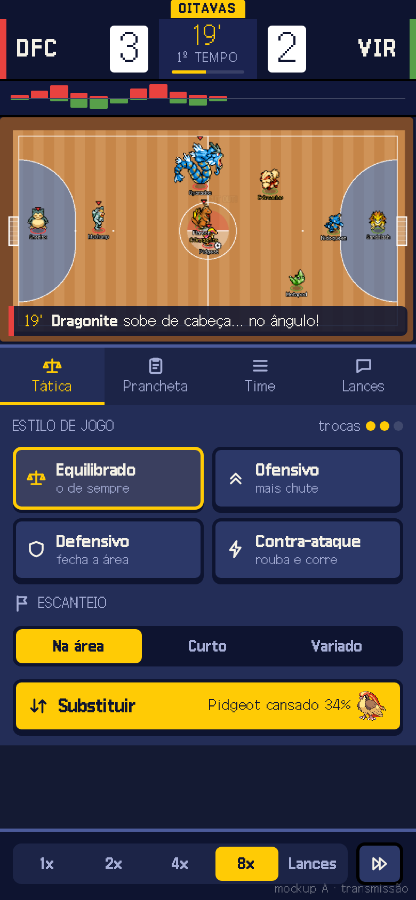
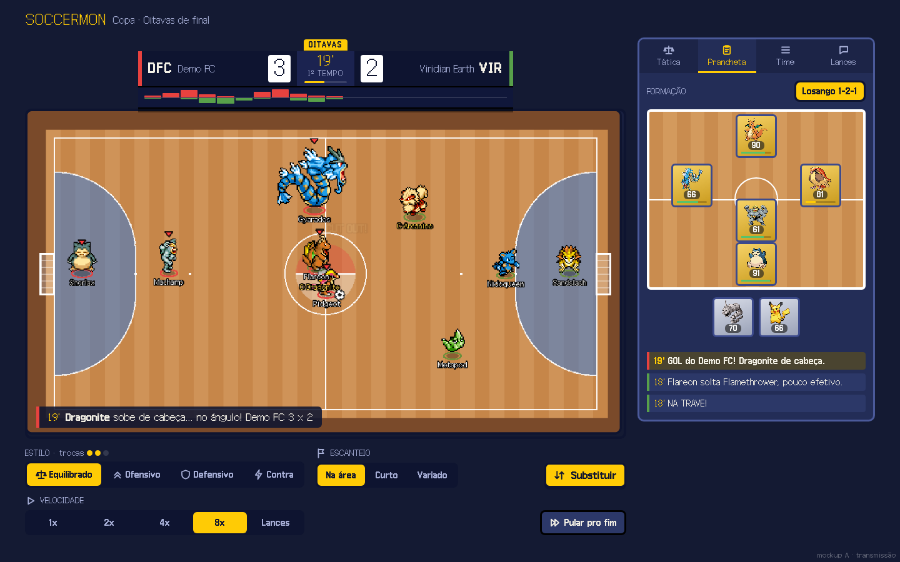
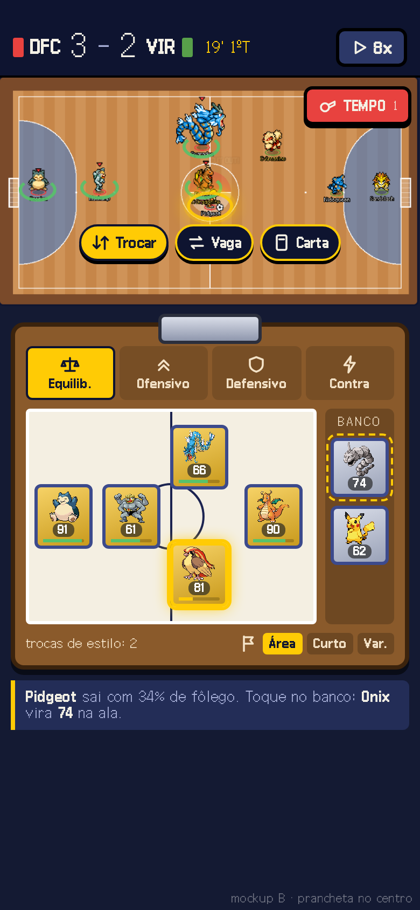
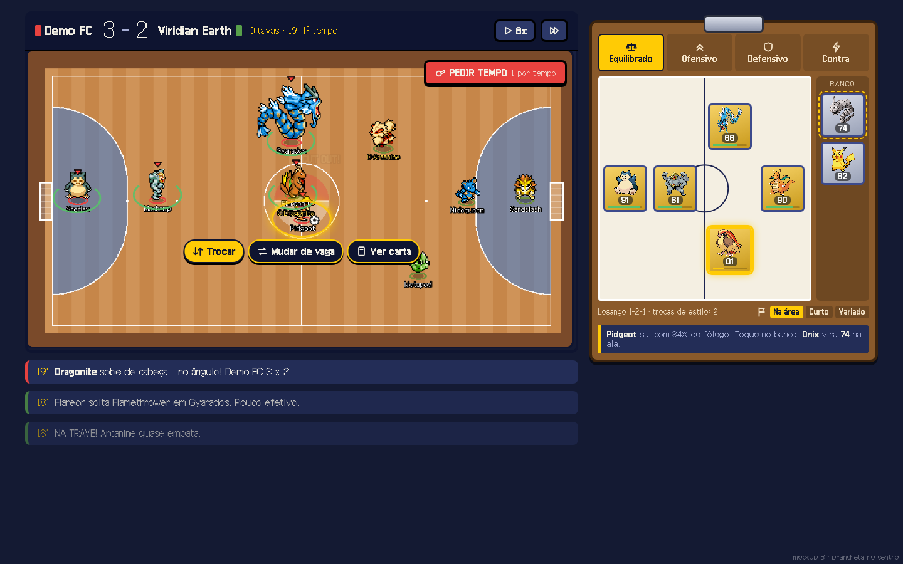
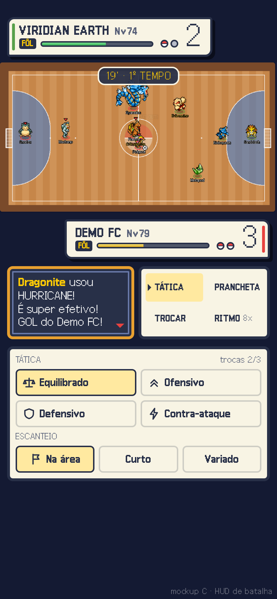
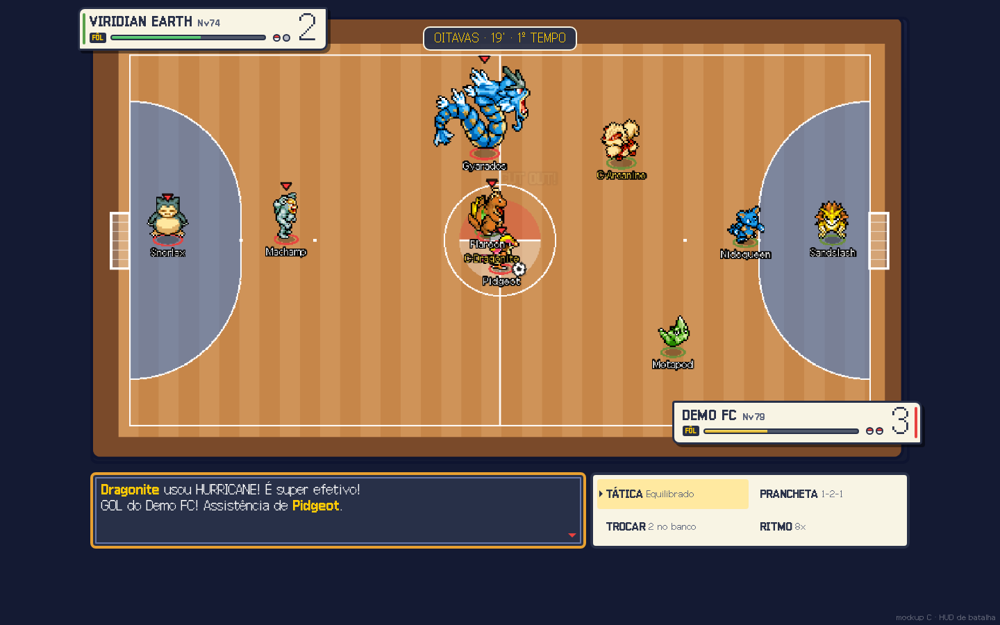

# Revamp da interface da partida (pesquisa, 18/10/2026)

Pedido do Miguel: "revamp da interface de jogo pra ficar mais interativo ou até melhor de ver, tipo o que fizemos com
a prancheta. Talvez um revamp do estilo do placar e UI."

Base: código da `int-086` (só leitura), partida aberta com `?demo=escanteio` em 320x568, 390x844, 844x390 e
1440x900 (Playwright headless). Prints em `hoje/`, mockups em `mockups/`.

## Resumo

- **O maior problema não é o estilo, é a ordem.** No celular em pé a quadra ocupa só 27% da tela (213 px de 844), a
  prancheta vem logo embaixo e **velocidade, tática e Substituir ficam a ~1.100 px do topo**: para mudar algo você
  tem que rolar e parar de ver o jogo. Deitado (844x390) é pior: nenhum controle aparece sem rolar.
- O placar é uma caixa genérica igual aos outros painéis: cor do time é só um quadradinho, "1 x 0" em minúsculo, a
  fase some no celular e o relógio continua "19' · 1º tempo" durante o intervalo (bug, ver abaixo).
- A narração mora no fim da página (1.700 px no celular): quase ninguém lê, e é ela que conta os golpes.
- Proponho 3 direções com mockup: **A · Transmissão** (placar de TV + painel do técnico em abas + barra do
  polegar), **B · Prancheta no centro** (toca no Pokémon na quadra, "Pedir tempo"), **C · HUD de batalha** (caixas de
  HP da Gen 3, caixa de texto, menu TÁTICA/PRANCHETA/TROCAR/RITMO).
- **Recomendo A**, em 3 passos: o que é CSS/JSX pequeno entra na 0.8.6 sem risco; abas e barra de pressão na 0.8.7;
  as interações de B (tocar na quadra, Pedir tempo) depois, com decisão sua.

## 1. Como está hoje

| Tamanho | Print |
|---|---|
| 390x844 (página inteira) | `hoje/390x844-pagina.png` |
| 390x844 no intervalo | `hoje/390x844-intervalo-pagina.png` |
| 320x568 (o que aparece na tela) | `hoje/320x568-tela.png` |
| 844x390 deitado | `hoje/844x390-tela.png` e `-pagina.png` |
| 1440x900 | `hoje/1440x900-pagina.png` e `-intervalo-` |

Sem rolagem pro lado em nenhum tamanho e sem erro no console.

### Diagnóstico

**Celular em pé (390 e 320)**
- Logo SOCCERMON (70 px) + placar (90 px) + quadra (213 px): a quadra é pequena e os nomes se embolam no meio
  ("CUT OUT!" em cima de Gyarados/Flareon/Dragonite).
- A ordem é quadra → prancheta (~500 px) → velocidade → tática → Substituir → escanteio → "Pular pro fim" →
  painel do time → narração. Tudo que é ação está longe da quadra e longe do polegar.
- 13 botões do mesmo peso em 4 linhas: velocidade, estilo, Substituir e escanteio parecem a mesma coisa. "Corners"
  fica sozinho como rótulo solto; "3 tactic changes left" flutua numa linha própria.
- Painel do time (fôlego, G, A, nota) repete o que a prancheta já mostra (fôlego e nota na vaga).
- Em 320 o nome do rival corta ("Viridian Ea…") e a sigla só aparece pro seu time.
- No intervalo, o painel aparece **embaixo da prancheta** e ainda diz "dá pra mudar a tática lá embaixo, nos
  controles": a própria tela admite que os controles estão espalhados.

**Deitado (844x390)**
- O placar sobe pro topo (bom) e a quadra enche a tela (bom), mas **nenhum controle aparece**: velocidade, tática e
  Substituir só rolando. Prancheta ao lado ok.

**Desktop (1440x900)**
- O melhor dos quatro, mas: placar de 1.590 px de largura com o centro vazio; escanteio e "Pular pro fim" na mesma
  linha (grupos misturados); painel do time fechado ocupa uma barra inteira; narração boa na coluna da direita.

**Placar**
- Igual a todos os outros painéis (borda azul, fundo escuro): não tem cara de transmissão nem de jogo.
- **Bug:** no intervalo o relógio mostra "19' · 1º tempo". A cena para no evento `halftime`
  (`MatchScene.ts` ~1414) mas o último `match:tick` veio com `phase: 'play'`, então `useClockLabel` nunca vê
  `'halftime'`. Conserto de uma linha em `Match.tsx`: passar `halftime ? { ...clock, phase: 'halftime' } : clock`
  pro `useClockLabel` (e o mesmo no `DuelMatch.tsx`).

**Duelo** (não abri ao vivo: precisa de duas contas no Supabase; li o `DuelMatch.tsx`): a `EmoteBar` fica embaixo
dos controles, ou seja, também abaixo da dobra no celular; o pedido de velocidade usa o mesmo grupo de botões.

**O que já está bom e fica:** a faixa diagonal de gol/defesa (`MatchHighlight`), o impacto/câmera lenta da 0.8.3, a
prancheta editável (só muda de lugar), o painel do intervalo.

## 2. Referências (o que vale roubar)

| Referência | O que faz bem | O que levar |
|---|---|---|
| Placares de TV (Sky/Premier League, Fox, NBC) | Placar e relógio primeiro, "proteja isso a todo custo"; resto em área secundária; animação só pra criar hierarquia por um instante | Placar compacto com faixa da cor do time, número em caixa branca, relógio com barrinha de progresso, fase numa etiqueta |
| Sofascore / FotMob "Attack Momentum" | Um gráfico de barras de pressão que conta o jogo sem lista de números | Barra de pressão embaixo do placar (já temos `dangerByPeriod` e `possessionByPeriod` em `engine/match-stats.ts`) |
| Football Manager (touchline shouts, FM10–FM24) | Mudar o jogo sem sair da partida; FM26 tirou os "gritos" e levou crítica por isso | Tática a um toque, sempre na tela, nunca num menu escondido |
| Top Eleven | "Dar ordens" é um botão fixo embaixo à direita; tática e troca numa tela só | Ação principal na zona do polegar |
| Retro Bowl | Pouquíssimos botões, decisões grandes e claras, sem sub-menus | Poucas decisões, bem grandes; intervalo como momento (já temos) |
| Rocket League | Placar no topo central, medidor que você lê de relance (boost) | Fôlego visível de relance (anéis na quadra ou barra do time) |
| Batalha Pokémon (Gen 3/4) | Caixa de HP com nome/nível/barra; caixa de texto que narra o golpe; menu 2x2 | Caixa de texto pros golpes; pokébolas pro banco; menu 2x2 |
| TFT / auto-battlers | Você assiste, mas o tabuleiro é a interface: toca no campeão e vê tudo dele | Tocar no Pokémon na quadra abre ações (B) |
| Zonas do polegar (Hoober, Unity) | Ação principal nos cantos de baixo; topo é pra ler | Barra fixa embaixo com velocidade e o botão principal |

## 3. As três direções

### A · Transmissão (recomendada)

 

O que muda:
- **Placar de transmissão**: sigla de 3 letras (DFC x VIR) sempre no celular, faixa na cor do time, gols em caixa
  branca grande, relógio amarelo com barrinha de progresso do tempo, fase ("OITAVAS") numa etiqueta. No desktop o
  nome inteiro aparece ao lado da sigla.
- **Barra de pressão** embaixo do placar (casa pra cima, rival pra baixo), mostrando só até o minuto atual.
- **Narração como "lower third"** em cima da quadra: a última frase entra, fica uns segundos e sai. A lista completa
  vai pra aba "Lances".
- **Quadra de ponta a ponta** no celular (sem a borda do painel, sem o logo da Home).
- **Painel do técnico em abas**: Tática | Prancheta | Time | Lances. Uma aba aberta de cada vez em vez de 4 painéis
  empilhados. A aba Tática tem os 4 estilos como peças grandes com ícone desenhado, trocas restantes como bolinhas,
  escanteio em seletor de 3, e Substituir grande com o aviso de quem está mais cansado ("Pidgeot cansado 34%": só
  informa, nada automático).
- **Barra do polegar** fixa embaixo: velocidade (1x 2x 4x 8x Lances) e "Pular pro fim". No duelo, o botão de emote
  entra ali.
- Desktop: placar em cima da quadra, controles agrupados embaixo dela (Estilo · Escanteio · Substituir / Velocidade
  · Pular), coluna da direita com as abas (Prancheta aberta por padrão) e as últimas falas.

Por que fica mais gostoso: você vê o jogo e mexe nele ao mesmo tempo; o placar tem cara de TV e a barra de pressão
conta a virada sem você ler nada; a narração aparece onde o olho já está.

Custo: **M** no total (mas dá pra fatiar: o placar e a narração em cima da quadra são P). Mexe só em
`MatchHud.tsx`, `Match.tsx`, `DuelMatch.tsx` e CSS; motor, save e cena Phaser intocados.
Riscos: a faixa de narração cobre um pedaço da quadra (fica embaixo, some sozinha e respeita "Reduzir movimento");
abas escondem a prancheta que a gente acabou de destacar (manter Prancheta como aba padrão no desktop e lembrar a
última aba); deitado precisa de layout próprio (abas na coluna da direita, barra do polegar por cima da quadra).

### B · Prancheta no centro (técnico na beira)

 

O que muda:
- Placar de uma linha (DFC 3 - 2 VIR · 19' 1ºT) com a velocidade num botão que gira a cada toque.
- **A quadra vira interface**: anel de fôlego no pé de cada Pokémon seu (verde → amarelo); tocar num Pokémon na
  quadra destaca ele e abre 3 pílulas: Trocar / Mudar de vaga / Ver carta.
- **"Pedir tempo"** (regra real do futsal: 1 tempo técnico por tempo): pausa a partida e abre a prancheta, como um
  mini intervalo. Só na Copa (no duelo precisaria de aceite dos dois, como a velocidade).
- A prancheta ganha cara de prancheta (clipe de metal, estilos como abas no topo, banco na beira à direita, escanteio
  no rodapé) e uma linha de ajuda contextual: "Pidgeot sai com 34%. Toque no banco: Onix vira 74 na ala".

Por que fica mais gostoso: é o mais interativo; o "tempo técnico" cria um momento de decisão com peso, e tocar no
próprio Pokémon é o gesto mais natural do celular.

Custo: **L**. Tocar na quadra já existe (`match:inspect` na cena abre o `PlayerInspect`), mas anéis de fôlego e
pílulas são Phaser + DOM sincronizados com a câmera (que dá zoom em gol e escanteio). "Pedir tempo" é regra nova:
pausar não muda o motor, mas é decisão de design sua.
Riscos: em 8x os Pokémon correm demais pra tocar (o "Pedir tempo" resolve); pílulas por cima da jogada; mais
coisa pra testar no celular deitado.

### C · HUD de batalha Pokémon

 

O que muda:
- Placar vira **duas caixas de batalha** da Gen 3: rival em cima à esquerda, você embaixo à direita, com nome,
  "Nv" do time (média da nota na vaga, regra carta = campo), barra de **fôlego do time** e **pokébolas = reservas**
  (apagada quando já entrou).
- Relógio num selo no topo da quadra.
- **Caixa de texto** de batalha pra narração ("Dragonite usou HURRICANE! É super efetivo!") com a setinha piscando.
- **Menu 2x2**: TÁTICA / PRANCHETA / TROCAR / RITMO, cada um abre o seu painel embaixo.

Por que fica mais gostoso: é a cara do jogo, nostalgia pura, e a caixa de texto dá palco pros golpes (encaixa na
regra do "jogo gostoso": crítico e super efetivo ganham texto).
Custo: **M**. Quase tudo DOM/CSS; "fôlego do time" e "Nv" saem dos snapshots e do `ratingAt`.
Riscos: dois cliques pra mudar a tática (menu → opção), o contrário de "mais interativo"; caixas creme brigam com o
resto do jogo (azul escuro, cartas minimalistas); placar dividido em duas caixas é pior de ler de relance (e pra print
no TikTok) que um placar só.

### Comparação

| | A · Transmissão | B · Prancheta no centro | C · Batalha |
|---|---|---|---|
| Ver e mexer ao mesmo tempo | sim (barra do polegar + aba Tática) | sim (toque na quadra) | meio (menu 2x2) |
| Placar de relance | muito bom | bom | fraco (2 caixas) |
| Cara de Pokémon | média | média | máxima |
| Toca motor/save | não | não (pausa é só tela) | não |
| Toca a cena Phaser | não | sim | não |
| Tamanho | M (fatiável, começa com P) | L | M |
| Risco | baixo | médio | médio (gosto) |

## 4. Recomendação e plano

**Direção A**, pegando de C a caixa de texto só nos golpes grandes (crítico/super efetivo, dentro da faixa de
narração) e deixando as interações de B (tocar na quadra, Pedir tempo) para depois, como sistema novo com ok seu.

### 0.8.6 (sem risco, ~1 dia, ~200 linhas, só CSS/JSX, nada de motor nem save)
1. Conserto do relógio no intervalo (`Match.tsx` e `DuelMatch.tsx`), com teste.
2. Placar novo (`Scoreboard` em `MatchHud.tsx` + CSS): sigla sempre no celular, faixa da cor do time, gols em
   caixa, relógio com barrinha, etiqueta da fase. Vale pra Copa e Duelo (mesmo componente).
3. Última frase da narração em cima da quadra (usa `lines[0]`, que já existe), some sozinha.
4. Celular em pé: controles (velocidade + Pular numa linha; estilo + Substituir; escanteio com ícone de bandeira)
   **antes** da prancheta, ou numa barra fixa embaixo só com a velocidade. Deitado: barra de velocidade por cima da
   quadra.
5. Opcional: esconder o logo SOCCERMON da partida no celular (+70 px de quadra).

### 0.8.7 (~2 a 3 dias, ~600 linhas)
6. Painel do técnico em abas (Tática | Prancheta | Time | Lances) substituindo os 4 painéis empilhados; lembra a
   última aba; desktop abre na Prancheta.
7. Barra de pressão (`dangerByPeriod` filtrado até o tick atual pra não dar spoiler, já que a partida vem
   pré-calculada).
8. Estilos como peças com ícone desenhado + trocas como bolinhas; Substituir com o aviso de cansaço.
9. Duelo: emotes na barra do polegar (um botão que abre os 6).
10. Caixa de texto de batalha só pra golpe crítico/super efetivo.

### 0.8.8+ (sistemas novos, decidir junto)
11. Tocar no Pokémon na quadra → Trocar / Vaga / Carta (a base é o `match:inspect` da cena).
12. Anéis de fôlego na quadra (Phaser).
13. "Pedir tempo" (1 por tempo, só Copa).

## 5. Decisões pro Miguel (recomendação primeiro)

1. Direção: **A** / B / C / outra mistura?
2. Narração: **faixa em cima da quadra + aba Lances** ou manter a lista sempre aberta no desktop?
3. Barra de pressão embaixo do placar: **entra** ou não?
4. Celular em pé: **barra fixa embaixo com a velocidade** (ocupa ~64 px) ou só subir os controles pra cima da
   prancheta?
5. Placar no celular sempre com **sigla** (DFC x VIR)?
6. Esconder o logo SOCCERMON durante a partida no celular: **sim** / não?
7. "Pedir tempo" (pausa com a prancheta aberta, 1 por tempo, só na Copa): entra no plano da 0.8.8 ou fica de fora?

## Arquivos

- `hoje/`: prints de hoje nos 4 tamanhos (tela e página inteira) e no intervalo (390 e 1440).
- `mockups/a-transmissao.html`, `b-prancheta.html`, `c-batalha.html` (+ `-390.png` e `-1440.png` de cada).
  Usam `base.css`, `icons.js` (ícones SVG desenhados, sem emoji), fontes Galmuri e sprites copiados em `assets/`, e
  `quadra.png` (print real da quadra; `quadra-gol.png` é o zoom do gol). Os mockups são estáticos: os anéis e as
  posições na quadra são aproximados.

## Fontes

- [Designing the Modern Scorebug (SVG, 2026)](https://www.sportsvideo.org/2026/06/09/designing-the-modern-scorebug-how-broadcast-graphics-teams-are-rethinking-the-most-important-element-on-screen/)
- [Score bug (Wikipedia)](https://en.wikipedia.org/wiki/Score_bug)
- [How Sofascore's Attack Momentum changed sport analysis](https://www.sofascore.com/news/how-sofascores-attack-momentum-changed-sport-analysis)
- [Football Manager 26 review: touchline shouts removidos (Potion)](https://www.useapotion.com/2025/11/football-manager-26-review-a-promising-rebuild-thats-not-quite-match-fit/)
- [Football Manager 2010 review (GameSpot)](https://www.gamespot.com/reviews/football-manager-2010-review/1900-6240556/)
- [Top Eleven: match day (SuperCheats)](https://www.supercheats.com/guides/top-eleven-football-manager/match-day)
- [Rocket League: interface e placar (ludo.guide)](https://www.ludo.guide/guide/rocket-league/the-ultimate-guide/1-5-understanding-the-user-interface-ui)
- [Rocket League: boost nos nomes (Epic)](https://www.epicgames.com/help/en-US/c-202300000001622/c-202300000001682/what-are-boost-nameplate-indicators-in-rocket-league-a202300000010040)
- [TFT Interface Update (Riot)](https://teamfighttactics.leagueoflegends.com/en-gb/news/game-updates/tft-interface-update/)
- [Best UX updates in Pokémon Sword & Shield (UX Collective)](https://uxdesign.cc/the-best-ux-updates-in-pok%C3%A9mon-sword-shield-8736e9b0746d)
- [CS50 Games: Pokémon (menus, caixas de texto, barras)](https://cs50.harvard.edu/games/notes/7/)
- [Mobile UI design best practices (Unity)](https://blog.unity.com/en/games/mobile-ui-design-best-practices-part-1)
- [The Thumb Zone (Smashing Magazine)](https://shop.smashingmagazine.com/2016/09/the-thumb-zone-designing-for-mobile-users)
- [Responsive game UI (portrait vs landscape)](https://www.abratabia.com/game-ui-design/responsive-game-ui.php)
